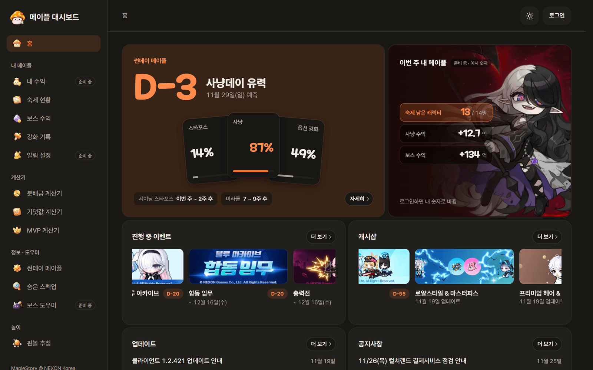

<p align="center">
  
</p>

<h1 align="center">메이플 대시보드</h1>

<p align="center">
  <b>메이플스토리의 계산 · 예측 · 숙제를 한곳에서.</b><br>
  혼자 기획 · 개발 · 운영하며 매일 직접 쓰는 사이트입니다.
</p>

<p align="center">
  <a href="https://maple-dashboard-eta.vercel.app"></a>
</p>

<p align="center">
  
  
  
  
</p>

<div align="center">

| <h3>1인</h3><sub>기획 · 개발 · 운영</sub> | <h3>193</h3><sub>커밋</sub> | <h3>401</h3><sub>자동 테스트</sub> | <h3>2026.08 –</h3><sub>운영 중</sub> |
| :---: | :---: | :---: | :---: |

<sub>2026-11-26 기준</sub>

</div>



> [!NOTE]
> 넥슨과 관계없는 비공식 팬 사이트입니다. 게임 데이터는 NEXON Open API, MapleStory © NEXON Korea.

## 풀어낸 문제

### 1. 넥슨 API 가 덜 채운 응답을 줄 때

- **문제** · 초기화 뒤 접속하지 않은 캐릭터는 보스 목록이 82줄 → 2줄, 주간 보스 한도가 12 → 0 으로 와서 숙제가 "다 끝남", 보스가 "0 / 0" 으로 보였습니다.
- **해결** · 최근 14일 중 마지막 정상 기록에서 등록 목록 · 한도를 가져오고, 완료 여부만 오늘 기록으로 판단하는 공용 함수(`lib/homework/thin.ts`)를 서버와 브라우저가 같이 씁니다. 연결 실패는 "없음"으로 기억하지 않습니다.

### 2. 공지가 이미지뿐일 때

- **문제** · 썬데이 혜택은 넥슨 API 에 없고 공지 본문이 이미지라, 매주 손으로 옮겨 적어야 했습니다.
- **해결** · Vercel Cron 이 공지를 찾아 CLOVA OCR 로 읽고 혜택 이름과 맞춥니다. 숫자가 어긋나거나 처음 보는 혜택은 바로 확정하지 않고 "확인 필요"로 남겨, 틀린 값이 조용히 저장되지 않게 했습니다. 2026-11-20 10:00 공지를 53분 만에 자동 기록했습니다.

### 3. 배포 뒤 느려진 응답

- **문제** · Vercel 함수와 DB 의 리전이 달라 화면이 늦게 떴습니다.
- **해결** · 함수를 서울(`icn1`)에 고정하고 조회를 캐싱해 응답을 수십 ~ 수백 ms 로 줄였습니다. 메뉴 아이콘은 318KB → 21KB 로 줄였습니다.

## 기능

| 기능 | 설명 |
| --- | --- |
| **기댓값 계산기** | 스타포스 · 잠재능력 · 추가옵션 · 소울 · 어빌리티의 평균 비용. 넥슨 공식 확률표 기준, 다른 계산 사이트 7곳과 결과를 맞춰 봄 |
| **강화 기록** | 내 스타포스 · 잠재 기록을 기댓값과 비교해 이득 · 손해 표시. 키와 기록은 브라우저에만 저장 |
| **썬데이 예측** | 이번 주 혜택 + 다음 썬데이 예측. 통계 + 표 데이터 모델(TabICL v2 · TabPFN v2, GitHub Actions 에서 매주 실행) + 확률 보정, 적중률 표시 |
| **숨은 스펙업** | 닉네임만 넣으면 놓친 스펙업을 찾아 줌(길드 단위도) |
| **숙제 현황 · 보스 수익** | 구글 로그인 → 넥슨 API 키 등록(암호화해 서버 보관) → 캐릭터별 일일 · 주간 숙제, 이번 주 결정석 · 보상 수익 |
| **관리자** | 결정석 · 큐브 · 메소 시세 같은 가격 기본값과 아이템 사전을 코드 수정 없이 화면에서 |
| **그 밖에** | 분배금 계산기 · MVP 계산기 · 핀볼 추첨 |

준비 중: 내 수익 · 알림 · 보스 도우미.

## 기술 구조

| 영역 | 쓴 것 |
| --- | --- |
| **화면** | Next.js 16 App Router · React 19 · TypeScript · Tailwind CSS v4 · shadcn/ui · 라이트 / 다크 |
| **서버 · 데이터** | Supabase Postgres · Auth(구글) · Server Actions. 넥슨 호출은 `lib/nexon/open-api.ts` 한 곳을 거침 |
| **자동화** | Vercel Cron(공지 OCR) · GitHub Actions(예측 모델) · `node --test` 자동 테스트 401개 |
| **개인정보** | 로그인 없이 쓰는 도구는 이름 · 이메일을 받지 않음. 수집하는 것은 사이트의 개인정보처리방침에 전부 적음 |

## 실행

```bash
npm install
cp .env.local.example .env.local   # 값 채우기
npm run dev                        # http://localhost:3000
npm test && npm run lint && npm run build
```

## 출처 · 표기

- 게임 데이터: NEXON Open API. MapleStory © NEXON Korea. 넥슨과 관계없는 비공식 팬 사이트
- 핀볼: [lazygyu/roulette](https://github.com/lazygyu/roulette) (MIT) 를 고쳐 씀, 물리 엔진 box2d-wasm (Zlib)
- 글꼴: Pretendard (`fonts/Pretendard/LICENSE.txt`) · 메이플스토리 서체 (`fonts/Maplestory/LICENSE.md`)
